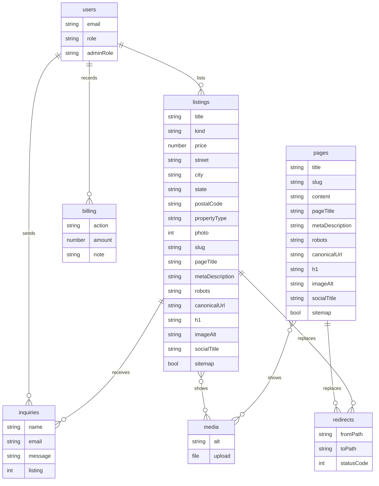

# Reatics 1.0 entity diagram

Reviewed October 19, 2026, against the approved scope. SEO fields are stored on pages and listings. A changed slug is stored in redirects as a 301. Inquiries are named here and are not a table yet.

`seo` is a set of fields on `pages` and `listings`, not its own table. The fields are slug, pageTitle, metaDescription, robots, canonicalUrl, h1, imageAlt, socialTitle, and sitemap. `robots` is index or noindex. `sitemap` says whether the record is included.

## Names kept

- Product role stays on `users.role`: space-seeker, broker, owner, broker-owner, coworking.
- Admin role stays on `users.adminRole`: owner, content-manager, moderator. There is no `roles` table.
- `owner` on `users.role` is Owner with listings. `owner` on `users.adminRole` is the staff Owner.
- `media` stays `media`. `billing` stays `billing`.
- `redirects.statusCode` is 301. A changed slug and a later move from the old domain use this one table.
- `inquiries` stores name, email, message, and an optional listing. It does not store providerPhone or providerEmail.

## Not in this diagram

companies, company-members, deals, deal-participants, screening-requests, lease-drafts, signed-documents, saved-searches, alerts, favorites, prospects, ads, referrals.

`users`, `pages`, `listings`, `media`, `billing`, and `redirects` are tables. SEO fields are stored on `pages` and `listings`. `inquiries` is named here and is not a table yet.
