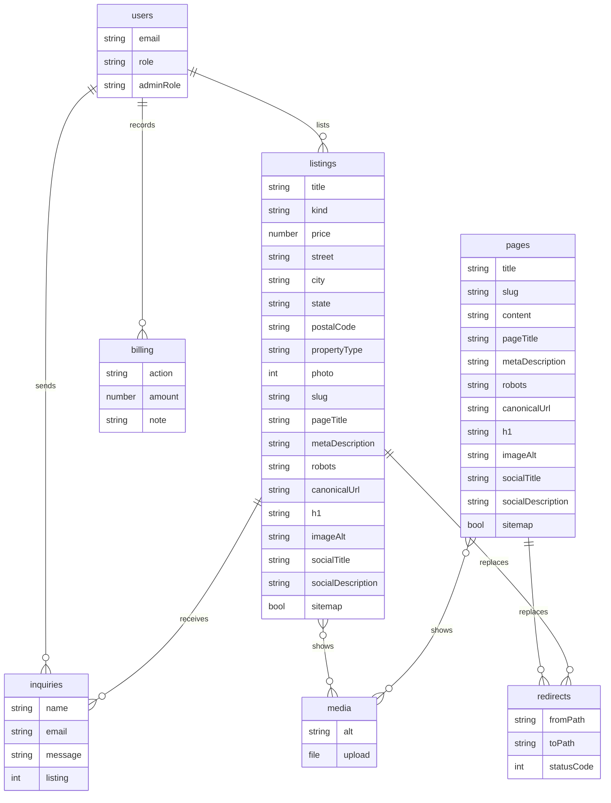
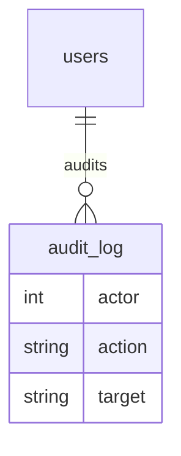
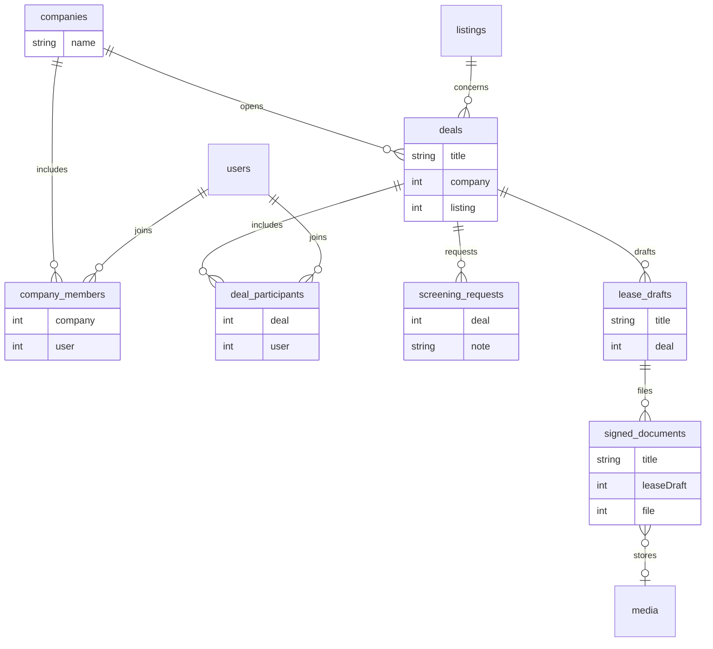
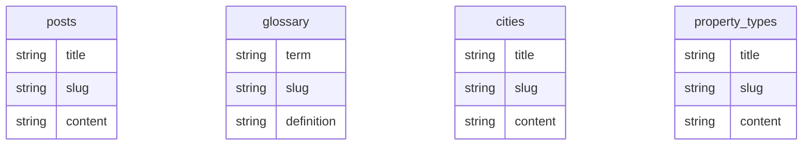

# Reatics 1.0 entity diagram

Reviewed October 26, 2026, against the approved scope. SEO fields are stored on pages, listings, posts, glossary terms, cities, and property types. A changed slug is stored in redirects as a 301. Inquiries are named here and are not a table yet. The Phase 2 tables were added empty on October 20, 2026. Marketing collections were added on October 26, 2026.

`seo` is a set of fields on `pages`, `listings`, `posts`, `glossary`, `cities`, and `property-types`, not its own table. The fields are slug, pageTitle, metaDescription, robots, canonicalUrl, h1, imageAlt, socialTitle, socialDescription, and sitemap. `robots` is index or noindex. `sitemap` says whether the record is included.

## Names kept

- Product role stays on `users.role`: space-seeker, broker, owner, broker-owner, coworking.
- Admin role stays on `users.adminRole`: owner, content-manager, moderator. There is no `roles` table.
- `owner` on `users.role` is Owner with listings. `owner` on `users.adminRole` is the staff Owner.
- `media` stays `media`. `billing` stays `billing`.
- `redirects.statusCode` is 301. A changed slug and a later move from the old domain use this one table.
- `inquiries` stores name, email, message, and an optional listing. It does not store providerPhone or providerEmail.

## Audit log

`audit-log` stores the time, actor, action, and target for a sign-in, a role change, and a deleted record. The Owner can read it.

`audit-log` is `audit_log` in the drawing.

## Phase 2, empty

companies, company-members, deals, deal-participants, screening-requests, lease-drafts, signed-documents.

These tables are empty. A deal can be created by hand in the admin. There are no landlord or applicant screens.

`company-members` is `company_members` in the drawing. `deal-participants` is `deal_participants`. `screening-requests` is `screening_requests`. `lease-drafts` is `lease_drafts`. `signed-documents` is `signed_documents`.

`users`, `pages`, `posts`, `glossary`, `cities`, `property-types`, `listings`, `media`, `billing`, `redirects`, and `audit-log` are tables. SEO fields are stored on `pages`, `listings`, `posts`, `glossary`, `cities`, and `property-types`. `inquiries` is named here and is not a table yet. `companies`, `company-members`, `deals`, `deal-participants`, `screening-requests`, `lease-drafts`, and `signed-documents` are Phase 2, empty.

## Marketing collections

posts, glossary, cities, and property-types. A content manager can edit them. A moderator cannot. Each slug is unique inside its collection.

`property-types` is `property_types` in the drawing.

## Publish

pages, posts, glossary, cities, and property-types have a status of draft or published. The body is rich text. A post also has publishedOn and an author.

## Not in this diagram

saved-searches, alerts, favorites, prospects, ads, referrals.
